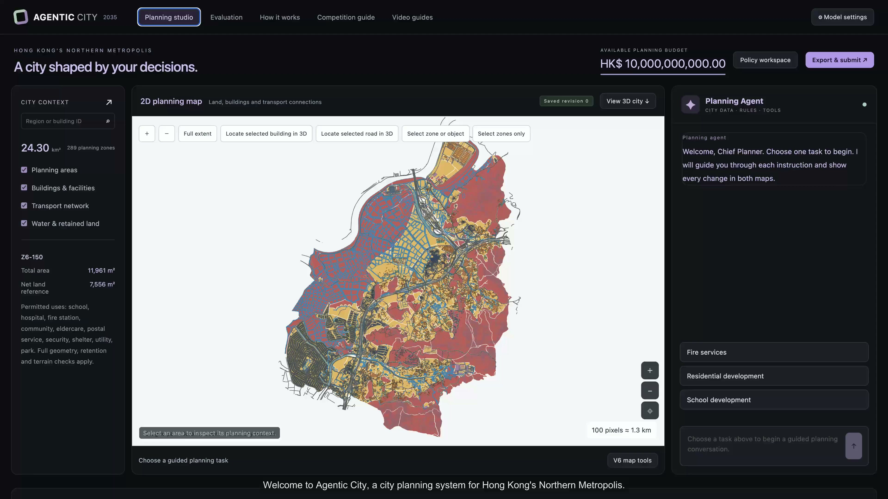
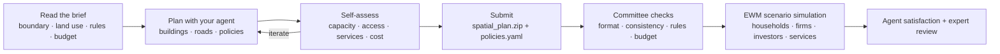

# Agentic City 2035

**An agent-native planning studio for Hong Kong's Northern Metropolis — where a city plan is built, priced, checked and submitted, not drawn on a slide.**



[中文版 →](README.zh-CN.md)

> **This repository is a showcase, not a release.** The platform's source code, city data and compiled model are not published. What is here: what the system does, how the competition works, and 28 short recordings of it running. See [NOTICE](NOTICE).

Agentic City is the planning platform behind the **Agentic City Global Challenge**. Participants act as Chief Planner of a **24.3 km²** slice of the Northern Metropolis — the Lok Ma Chau Loop, San Tin and Ngau Tam Mei, with parts of Mai Po and Fairview Park — and deliver a complete **2035** spatial plan plus a policy package inside a fixed **HK$ 10,000,000,000** budget.

## The idea in four lines

- **The city is a state machine, not a picture.** Zoning, permitted uses, buildable land, demolition and pond-filling rules, the road graph, capacity and prices are machine-readable. Every operation is checked, priced, versioned and undoable, and the 2D plan and 3D city are two views of one plan.
- **The agent is a colleague, not a chat box.** You describe an intent; the assistant turns it into a concrete proposal and its cost, then stops. Nothing is built until you approve it. Spending is the boundary between conversation and consequence.
- **The plan is meant to be run.** A submission is machine-readable, and the committee loads it into an Economic World Model where households, firms, investors and service organisations live inside it.
- **Two different agents.** The *planning agent* helps you operate the city. The *city agent* lives in it. The first makes the tool usable; the second is what makes the city agentic.

## Watch it

Two films, cut into chapters. Every clip plays inline — pick the question you care about.

If a player sits at 0:00, hard-refresh the page (⌘⇧R / Ctrl+F5): GitHub caches rendered READMEs, and a stale copy points at video sources that no longer exist. Every clip is also listed in [issue #1](https://github.com/Planet-300894/Agentic-City/issues/1), where each one opens directly.

### Competition workflow · 18 chapters · 5:47

#### 2-01 · The 2035 challenge · 22s

<video src="https://github.com/user-attachments/assets/d7d17ee5-c8a5-4a43-9e4d-c4281c0c76f1" controls></video>

#### 2-02 · Read the brief, set objectives · 19s

<video src="https://github.com/user-attachments/assets/05b271d1-22c8-4a5c-870c-7fdc3acaf1d6" controls></video>

#### 2-03 · Fire station siting and cost · 27s

<video src="https://github.com/user-attachments/assets/e35b8ee5-d53e-48d8-8995-663f57d42597" controls></video>

#### 2-04 · Self-assessment: 4.92 min · 15s

<video src="https://github.com/user-attachments/assets/0163afd4-1691-4b67-a14e-2e3e63568382" controls></video>

#### 2-05 · A new road: 3.44 min · 19s

<video src="https://github.com/user-attachments/assets/fbaea29a-2e6e-47b3-8e72-b945203182eb" controls></video>

#### 2-06 · Choosing a residential site · 18s

<video src="https://github.com/user-attachments/assets/e8ced3fb-a728-4e58-b5fc-99380aa974e7" controls></video>

#### 2-07 · Demolition and pond filling · 22s

<video src="https://github.com/user-attachments/assets/94178e65-3f53-4a41-b99b-be9c47dc97a0" controls></video>

#### 2-08 · Six blocks, 46,576 residents · 24s

<video src="https://github.com/user-attachments/assets/b0e7aa94-b2c4-4dbd-84d8-7d1634c60ada" controls></video>

#### 2-09 · Supporting policies · 17s

<video src="https://github.com/user-attachments/assets/35b2c12d-f6bf-4442-ab89-5db7aea21527" controls></video>

#### 2-10 · The other assessment dimensions · 18s

<video src="https://github.com/user-attachments/assets/bed2ee5c-1f4b-402c-9430-7cb129343e2c" controls></video>

#### 2-11 · Self-check before submission · 18s

<video src="https://github.com/user-attachments/assets/f472235c-ed1d-4a44-925c-3be4b6e62775" controls></video>

#### 2-12 · Submission: the spatial package · 30s

<video src="https://github.com/user-attachments/assets/673028df-ec84-4053-b17c-e6459f4d4e6a" controls></video>

#### 2-13 · Submission: the policy file · 16s

<video src="https://github.com/user-attachments/assets/2f830640-11d7-41ae-83ef-c408755e785a" controls></video>

#### 2-14 · Committee validation · 15s

<video src="https://github.com/user-attachments/assets/cdf07d23-b10a-48bb-9915-57716eced035" controls></video>

#### 2-15 · Introducing the Economic World Model · 12s

<video src="https://github.com/user-attachments/assets/42312dd2-1b4a-4ca3-b07c-c57defa2fa82" controls></video>

#### 2-16 · The plan becomes an environment · 23s

<video src="https://github.com/user-attachments/assets/55df9a5b-fb8e-42fa-97b4-afc0586e88ec" controls></video>

#### 2-17 · How space and policy shape choices · 24s

<video src="https://github.com/user-attachments/assets/60d171ea-dee7-4e62-9392-2ab9be6a8fc6" controls></video>

#### 2-18 · What the competition looks for · 12s

<video src="https://github.com/user-attachments/assets/39c98a2f-54e5-4d3b-9f77-744648a8e9d4" controls></video>


### System introduction · 10 chapters · 3:20

#### 1-01 · What Agentic City is · 14s

<video src="https://github.com/user-attachments/assets/ded8ed8c-3212-46cf-bd18-8275794b2629" controls></video>

#### 1-02 · The planning area and its baseline · 25s

<video src="https://github.com/user-attachments/assets/6ef553c3-e635-4c7a-a720-efbef2c6409b" controls></video>

#### 1-03 · The 2D map: uses, limits, buildable land · 23s

<video src="https://github.com/user-attachments/assets/3cd989f6-6122-4a4d-be83-97543766e252" controls></video>

#### 1-05 · The 3D city, in sync with the plan · 21s

<video src="https://github.com/user-attachments/assets/2dbbbefb-eeb0-4987-a8ed-ac5235e55dbf" controls></video>

#### 1-06 · The planning assistant · 20s

<video src="https://github.com/user-attachments/assets/57fd1574-6344-4273-bbce-39d6ee19b159" controls></video>

#### 1-07 · Spending needs approval · 18s

<video src="https://github.com/user-attachments/assets/124c3349-551d-436c-bb9c-53f6156b3dae" controls></video>

#### 1-08 · The policy workspace · 18s

<video src="https://github.com/user-attachments/assets/2bdca1f1-b9a1-4977-b794-dfca78e90184" controls></video>

#### 1-09 · Seven assessment groups · 26s

<video src="https://github.com/user-attachments/assets/9cf7e4fd-f529-4b61-ab66-7492f9098270" controls></video>

#### 1-10 · Model settings: bring your own agent · 21s

<video src="https://github.com/user-attachments/assets/2d53bf7f-ccaf-4aae-8a2d-1439da6d6866" controls></video>

#### 1-11 · What the platform connects · 14s

<video src="https://github.com/user-attachments/assets/fdcd4398-cdf5-4398-82ee-fbd42b7fdfba" controls></video>


## What the demonstration establishes

| Scenario | What the participant does | What the city answers |
|---|---|---|
| Fire services | Names three eligible sites, approves construction, later proposes one ~146 m access road | Mean response **4.92 → 3.44 min (−30%)** |
| Residential | Picks a site, demolishes a building, fills a pond, builds six blocks | **+660 residents → 46,576** city capacity |
| School | Sites a campus on buildable land, assigns three residential origins | **450 places**, **9.33 min** mean journey |

None of these numbers is typed in: the capacity and travel figures are computed on the actual V6 network.

## The competition loop



The loop is the point: **plan → simulate → observe → iterate.** Assessment is not a verdict at the end; it is the signal that drives the next revision.

## Assessment

| Group | Indicators |
|---|---|
| Housing & city capacity | Resident capacity, owner/renter split, affordability |
| Mobility & accessibility | Cross-boundary, commuting, school and shopping travel times |
| Public-service capacity | School places, hospital beds, waste collection |
| Safety & resilience | Fire and ambulance response, flooding |
| Environment & climate | Green space per capita, emissions, sustainable-mode share |
| Economy & employment | Firm capacity and sector mix, jobs, regional GDP |
| Hong Kong–Shenzhen exchange | Economic flow, population movement |

## Scope

This is a **demonstration of the intended system**, and it is worth being precise about which parts are real.

**Real** — the V6 city model (24.3 km², 20,924 existing buildings, zoning, terrain, water, routed network); rule checking; operation pricing; the HK$ 10 bn ledger; approval-before-spend; drafts and undo; export; 2D/3D synchronisation.

**Staged** — the guided scenarios are fixed, pre-validated scripts with precomputed indicator values; model settings is an interface without a live model connection; the committee simulation is described rather than executed.

The films show the interface and the workflow. They do not expose the implementation.

## Repository

```
├── README.md              this file
├── README.zh-CN.md        Chinese version
├── NOTICE                 no licence granted; showcase and evaluation only
├── docs/
│   ├── architecture.md    layers, data flow, the two agents
│   ├── competition-flow.md  participant stages, submission format, judging
│   └── roadmap.md         demo → live agent loop → city agents
└── media/                 posters, transcripts, subtitles, chapter timings
```

The chapter clips are hosted as GitHub attachments in [issue #1](https://github.com/Planet-300894/Agentic-City/issues/1). Deleting that issue would break every player above.

## Credits

Part of the **Agentic City Global Challenge** for Hong Kong's Northern Metropolis, organised by Shenzhen He Tao College and The Chinese University of Hong Kong, Shenzhen, with the Shenzhen Big Data Research Institute as technical partner.

City model compiled from official Hong Kong mapping and water data (iB1000), OpenStreetMap road and transit networks, and public building and land-use records.

© 2026 Jing Qian. All rights reserved — see [NOTICE](NOTICE).
