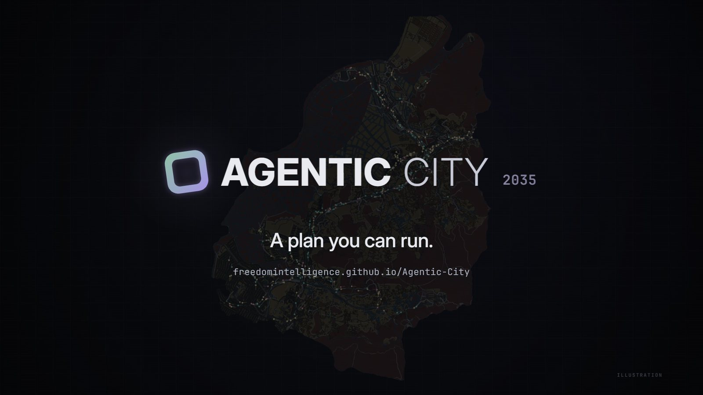
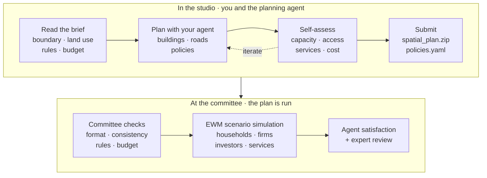
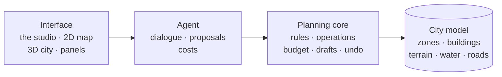

<div align="center">

<a href="https://freedomintelligence.github.io/Agentic-City/"></a>

# Agentic City 2035

### A city plan you can run.

An agent-native planning studio for Hong Kong's Northern Metropolis,<br>
where a city plan is built, priced, checked and submitted, not drawn on a slide.

**[Website](https://freedomintelligence.github.io/Agentic-City/)** &nbsp;·&nbsp;
**[Watch the film](https://freedomintelligence.github.io/Agentic-City/#film)** &nbsp;·&nbsp;
**[Try the live demo](https://challenge.economic-world-model.com/demo/agentic-city/)** &nbsp;·&nbsp;
**[The challenge](https://challenge.economic-world-model.com/agentic-city.html)** &nbsp;·&nbsp;
**[中文](README.zh-CN.md)**

<table>
<tr>
<td align="center" width="20%"><b>24.3 km²</b><br><sub>planning area</sub></td>
<td align="center" width="20%"><b>289</b><br><sub>planning zones</sub></td>
<td align="center" width="20%"><b>20,924</b><br><sub>existing buildings</sub></td>
<td align="center" width="20%"><b>HK$ 10 bn</b><br><sub>fixed budget</sub></td>
<td align="center" width="20%"><b>2035</b><br><sub>target year</sub></td>
</tr>
</table>

</div>

> [!NOTE]
> **This repository is a showcase, not a release.** The platform's source code, city data and compiled model are not published. What is here: what the system does, how the competition works, and 28 short recordings of it running. See [NOTICE](NOTICE).

Agentic City is the planning platform behind the **Agentic City Global Challenge**. Participants act as Chief Planner of a **24.3 km²** slice of the Northern Metropolis (the Lok Ma Chau Loop, San Tin and Ngau Tam Mei, with parts of Mai Po and Fairview Park) and deliver a complete **2035** spatial plan plus a policy package inside a fixed **HK$ 10,000,000,000** budget.

<p align="center">
<a href="#the-idea-in-four-lines">Idea</a> ·
<a href="#watch-it">Watch</a> ·
<a href="#what-the-demonstration-establishes">Evidence</a> ·
<a href="#the-competition-loop">Loop</a> ·
<a href="#how-it-is-built">Architecture</a> ·
<a href="#assessment">Assessment</a> ·
<a href="#scope">Scope</a> ·
<a href="#roadmap">Roadmap</a> ·
<a href="#documentation">Docs</a>
</p>

## The idea in four lines

<table>
<tr>
<td width="50%" valign="top">

**1 · The city is a state machine, not a picture.**

Zoning, permitted uses, buildable land, demolition and pond-filling rules, the road graph, capacity and prices are machine-readable. Every operation is checked, priced, versioned and undoable, and the 2D plan and 3D city are two views of one plan.

</td>
<td width="50%" valign="top">

**2 · The agent is a colleague, not a chat box.**

You describe an intent; the assistant turns it into a concrete proposal and its cost, then stops. Nothing is built until you approve it. Spending is the boundary between conversation and consequence.

</td>
</tr>
<tr>
<td width="50%" valign="top">

**3 · The plan is meant to be run.**

A submission is machine-readable, and the committee loads it into an Economic World Model where households, firms, investors and service organisations live inside it.

</td>
<td width="50%" valign="top">

**4 · Two different agents.**

The *planning agent* helps you operate the city. The *city agent* lives in it. The first makes the tool usable; the second is what makes the city agentic.

</td>
</tr>
</table>

## Watch it

### The idea, in 94 seconds

<a href="https://freedomintelligence.github.io/Agentic-City/#film"></a>

**[A Plan You Can Run](https://freedomintelligence.github.io/Agentic-City/#film)** · 1:34 · narrated in English or Chinese. A short film cut from the project's own recordings: why a plan should be a machine, why the agent stops before it spends, and what it means to run a city plan. It plays on the [project site](https://freedomintelligence.github.io/Agentic-City/#film), where you can also click the approval step yourself.

### The studio at work: six chapters to start with

Two films, cut into 28 chapters. Every clip plays inline. These six carry the argument; **[all 28 are in the chapter index →](docs/chapters.md)**

|  |  |
|---|---|
| https://github.com/user-attachments/assets/57fd1574-6344-4273-bbce-39d6ee19b159 | https://github.com/user-attachments/assets/124c3349-551d-436c-bb9c-53f6156b3dae |
| **1-06** · The planning assistant · 20s | **1-07** · Spending needs approval · 18s |
| https://github.com/user-attachments/assets/e35b8ee5-d53e-48d8-8995-663f57d42597 | https://github.com/user-attachments/assets/fbaea29a-2e6e-47b3-8e72-b945203182eb |
| **2-03** · Fire station siting and cost · 27s | **2-05** · A new road: 3.44 min · 19s |
| https://github.com/user-attachments/assets/b0e7aa94-b2c4-4dbd-84d8-7d1634c60ada | https://github.com/user-attachments/assets/55df9a5b-fb8e-42fa-97b4-afc0586e88ec |
| **2-08** · Six blocks, 46,576 residents · 24s | **2-16** · The plan becomes an environment · 23s |

If a player sits at 0:00, hard-refresh the page (⌘⇧R / Ctrl+F5). Every clip is also listed in [issue #1](../../issues/1).

| Film | Chapters | Length | Covers |
|---|:-:|:-:|---|
| [System introduction](docs/chapters.md#system-introduction--10-chapters--320) | 10 | 3:20 | the planning area, the 2D map and 3D city, the planning assistant, approval, policy, the seven assessment groups, model settings |
| [Competition workflow](docs/chapters.md#competition-workflow--18-chapters--547) | 18 | 5:47 | the brief, fire stations and a new road, a residential site, policies, self-check, the two submission files, committee validation, the Economic World Model |

## What the demonstration establishes

| Scenario | What the participant does | What the city answers |
|---|---|---|
| Fire services | Names three eligible sites, approves construction, later proposes one ~146 m access road | Mean response **4.92 → 3.44 min (−30%)** |
| Residential | Picks a site, demolishes a building, fills a pond, builds six blocks | **+660 residents → 46,576** city capacity |
| School | Sites a campus on buildable land, assigns three residential origins | **450 places**, **9.33 min** mean journey |

None of these numbers is typed in: the capacity and travel figures are computed on the actual V6 network.

## The competition loop



The loop is the point: **plan → simulate → observe → iterate.** Assessment is not a verdict at the end; it is the signal that drives the next revision. The stages, the two submission files and the judging are described in [docs/competition-flow.md](docs/competition-flow.md).

## How it is built

Four layers on one shared city record. The property that matters is that **nothing is stored twice**: the 2D plan, the 3D city, the assessment panel and the agent conversation all read and write the same plan state.



The agent turns intent into a concrete proposal, and then **stops**:

```
intent → resolve against the city model → propose operations
       → validate → price → request approval → execute → re-assess
```

*The agent proposes, the human approves, the core executes.* That contract is the design decision the whole product rests on, and it is why a language model can be given write access to a city at all. More in [docs/architecture.md](docs/architecture.md).

| | **Planning agent** | **City agent** |
|---|---|---|
| Serves | the participant | the simulated city |
| Does | turns intent into a rule-checked, priced proposal | lives in the plan: chooses housing, work, travel, consumption, investment |
| Output | an operation, awaiting approval | behaviour, and a verdict on the city |
| Where it runs | inside the studio | inside the Economic World Model, after submission |

## Assessment

| Group | Indicators |
|---|---|
| Housing & city capacity | Resident capacity, owner/renter split, affordability |
| Mobility & accessibility | Cross-boundary, commuting, school and shopping travel times |
| Public-service capacity | School places, hospital beds, waste collection |
| Safety & resilience | Fire and ambulance response, flooding |
| Environment & climate | Green space per capita, emissions, sustainable-mode share |
| Economy & employment | Firm capacity and sector mix, jobs, regional GDP |
| Hong Kong–Shenzhen exchange | Economic flow, population movement |

## Scope

This is a **demonstration of the intended system**, and it is worth being precise about which parts are real.

<table>
<tr><th width="50%">Real</th><th width="50%">Staged</th></tr>
<tr>
<td valign="top">

- the V6 city model: 24.3 km², 20,924 existing buildings, zoning, terrain, water, routed network
- rule checking
- operation pricing
- the HK$ 10 bn ledger
- approval-before-spend
- drafts and undo
- export
- 2D/3D synchronisation

</td>
<td valign="top">

- the guided scenarios are fixed, pre-validated scripts with precomputed indicator values
- model settings is an interface without a live model connection
- the committee simulation is described rather than executed
- in the idea film and on the project site, the traffic drawn on the plan is an illustration

</td>
</tr>
</table>

The films show the interface and the workflow. They do not expose the implementation.

## Roadmap

The demo is not a cut-down version of the final product. It is the **interface contract** of the final product, with the reasoning replaced by scripts. The roadmap is the order in which the scripts get replaced by real machinery.

| Phase | What changes | What it proves, or its exit criterion |
|---|---|---|
| **1 · Demo** (current) | Guided scenarios replay fixed, pre-validated steps on the real city model, rules, pricing and ledger | *Proves:* a planning decision can be expressed as an intent, priced, approved and reflected in the city within one workspace |
| **2 · Live planning loop** | A model connection, a stable tool surface, recomputed indicators, refusal, clean exports | *Exit:* a participant with no prior knowledge completes a small plan in natural language, with no preset prompts, and the exported files pass validation |
| **3 · City agents (EWM)** | The plan becomes a running environment for household, firm, investor, developer and service agents | *Exit:* the same submitted plan, run twice, produces the same result; and two plans that score identically on static capacity produce visibly different social outcomes |
| **4 · Public platform** | Scenario packs and reference results, a submission validator, a public gallery, reusable region packs | *Must keep:* reproducibility |

Each phase must keep the previous phase's guarantee: *nothing happens to the city without a cost, a rule check and a human decision.* Details in [docs/roadmap.md](docs/roadmap.md).

## Documentation

| | |
|---|---|
| [docs/architecture.md](docs/architecture.md) | layers, data flow, the two agents |
| [docs/competition-flow.md](docs/competition-flow.md) | participant stages, submission format, judging |
| [docs/roadmap.md](docs/roadmap.md) | demo → live agent loop → city agents |
| [docs/chapters.md](docs/chapters.md) | all 28 chapter clips, with what each one shows |
| [media/](media) | posters, transcripts, subtitles, chapter timings |
| [NOTICE](NOTICE) | no licence granted; showcase and evaluation only |

The chapter clips are hosted as GitHub attachments in [issue #1](../../issues/1). Deleting that issue would break every player in this repository and on the project site.

## Credits

Part of the **Agentic City Global Challenge** for Hong Kong's Northern Metropolis, organised by Shenzhen Loop Area Institute, The Chinese University of Hong Kong, Shenzhen, and Nanyang Technological University, with the Shenzhen Big Data Research Institute as technical partner. Agentic City is the world behind [Track 3 of the Economic World Model Challenge](https://challenge.economic-world-model.com/agentic-city.html).

City model compiled from official Hong Kong mapping and water data (iB1000), OpenStreetMap road and transit networks, and public building and land-use records.

The Economic World Model that the committee stage builds on is described in:

```bibtex
@article{han2026economic,
  title   = {From Economic Agents to Agentic Economies: A Systems Blueprint for Economic World Models},
  author  = {Han, Jiale and Li, Xiang and Qian, Jing and Gu, Wenyuan and Gao, Pin and Luo, Ye and Zha, Hongyuan and Tao, Dacheng and Wang, Benyou and Cong, Lin William},
  journal = {arXiv preprint arXiv:2608.06020},
  year    = {2026}
}
```

© 2026 Jing Qian. All rights reserved. See [NOTICE](NOTICE).
