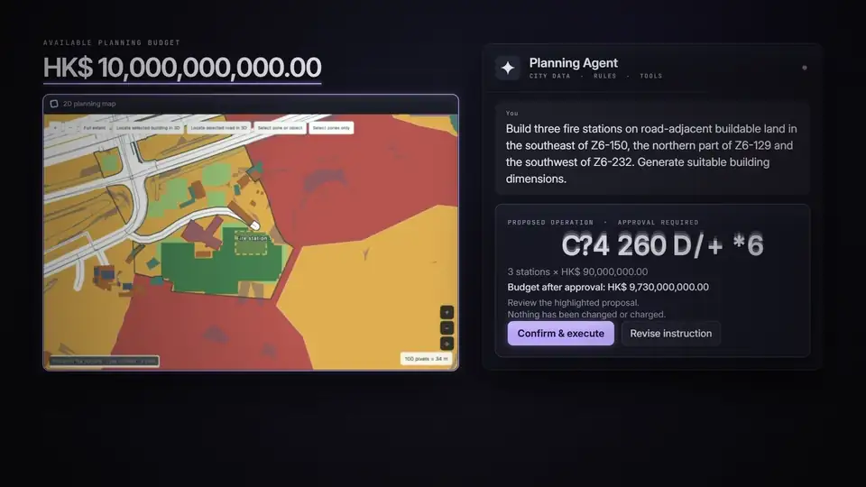
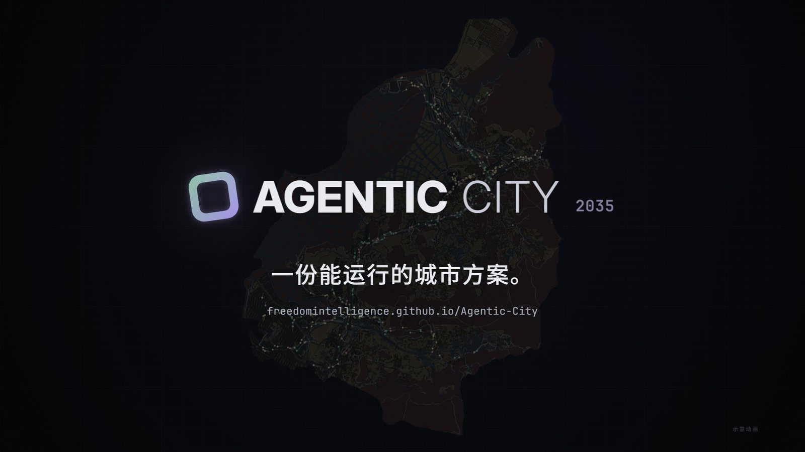
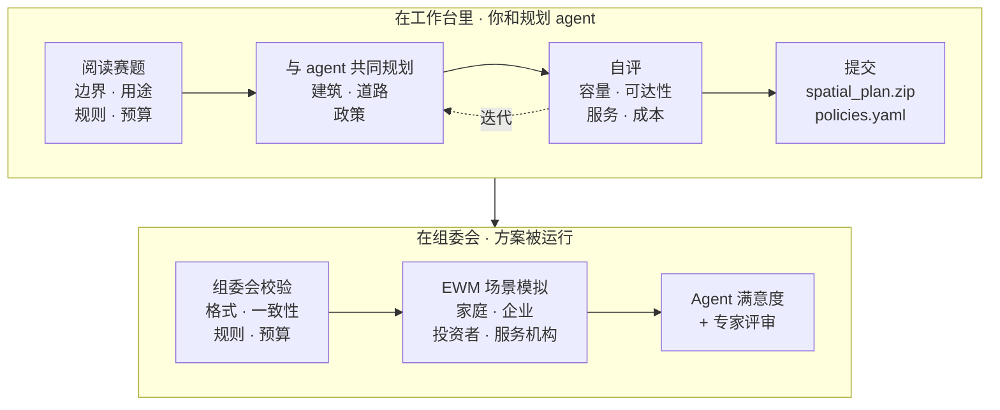

<div align="center">

<a href="https://freedomintelligence.github.io/Agentic-City/?lang=zh"></a>

# Agentic City 2035

### 一份能运行的城市方案

面向香港北部都会区的 agent 原生规划工作台，<br>
城市方案在这里被建造、计价、校验和提交，而不是画在幻灯片上。

**[项目主页](https://freedomintelligence.github.io/Agentic-City/?lang=zh)** &nbsp;·&nbsp;
**[观看影片](https://freedomintelligence.github.io/Agentic-City/?lang=zh#film)** &nbsp;·&nbsp;
**[体验在线 Demo](https://challenge.economic-world-model.com/demo/agentic-city/)** &nbsp;·&nbsp;
**[挑战赛](https://challenge.economic-world-model.com/agentic-city.html)** &nbsp;·&nbsp;
**[English](README.md)**

<table>
<tr>
<td align="center" width="20%"><b>24.3 km²</b><br><sub>规划范围</sub></td>
<td align="center" width="20%"><b>289</b><br><sub>规划分区</sub></td>
<td align="center" width="20%"><b>20,924</b><br><sub>现状建筑</sub></td>
<td align="center" width="20%"><b>100 亿港元</b><br><sub>固定预算</sub></td>
<td align="center" width="20%"><b>2035</b><br><sub>目标年份</sub></td>
</tr>
</table>

</div>

> [!NOTE]
> **这个仓库是展示，不是发布。** 平台的源码、城市数据与编译模型均未公开。这里有：系统在做什么、比赛如何进行，以及 28 段运行录像。详见 [NOTICE](NOTICE)。

Agentic City 是 **Agentic City 全球挑战赛**的规划平台。参赛者以“首席规划师”身份，负责北部都会区中一片 **24.3 平方公里** 的区域（落马洲河套、新田、牛潭尾，含米埔及锦绣花园部分范围），在 **100 亿港元** 固定预算内，交付面向 **2035 年** 的空间方案与政策方案。

<p align="center">
<a href="#四个要点">理念</a> ·
<a href="#观看">观看</a> ·
<a href="#演示验证了什么">验证</a> ·
<a href="#参赛闭环">闭环</a> ·
<a href="#系统如何搭建">架构</a> ·
<a href="#评估体系">评估</a> ·
<a href="#当前范围">范围</a> ·
<a href="#路线图">路线图</a> ·
<a href="#文档">文档</a>
</p>

## 四个要点

<table>
<tr>
<td width="50%" valign="top">

**1 · 城市是状态机，不是一张图。**

分区、允许用途、可建范围、拆迁与填塘规则、路网、容量与造价全部机器可读。每次操作都经过校验、计价、留版本、可撤销；2D 与 3D 是同一份方案的两个视图。

</td>
<td width="50%" valign="top">

**2 · Agent 是同事，不是聊天框。**

你说意图，助手给出具体方案和价格，然后停下。你不确认，它不动工。花钱，就是“对话”与“后果”的分界线。

</td>
</tr>
<tr>
<td width="50%" valign="top">

**3 · 方案是要被运行的。**

提交物机器可读，组委会把它灌进经济世界模型，让家庭、企业、投资者与服务机构在里面生活。

</td>
<td width="50%" valign="top">

**4 · 两个不同的 agent。**

*规划 agent* 帮你操作城市；*城市 agent* 住在城市里。前者让工具可用，后者才让城市“agentic”。

</td>
</tr>
</table>

## 观看

### 94 秒，讲清理念

<a href="https://freedomintelligence.github.io/Agentic-City/?lang=zh#film"></a>

**[《一份能运行的城市方案》](https://freedomintelligence.github.io/Agentic-City/?lang=zh#film)** · 1 分 34 秒 · 中英两版旁白。一支用项目自己的录屏剪成的短片：为什么方案应该是一台机器，为什么 Agent 在花钱之前要停下，以及“运行一份城市方案”到底是什么意思。影片在[项目主页](https://freedomintelligence.github.io/Agentic-City/?lang=zh#film)播放，在那里你还可以亲手点一下“确认”。

### 工作台实录：先看这六段

两部影片共切成 28 章，每段都在页面内直接播放。这六段撑起了主线；**[全部 28 段见章节索引 →](docs/chapters.zh-CN.md)**

|  |  |
|---|---|
| https://github.com/user-attachments/assets/57fd1574-6344-4273-bbce-39d6ee19b159 | https://github.com/user-attachments/assets/124c3349-551d-436c-bb9c-53f6156b3dae |
| **1-05** · 规划助手 · 20s | **1-06** · 花钱必须确认 · 18s |
| https://github.com/user-attachments/assets/e35b8ee5-d53e-48d8-8995-663f57d42597 | https://github.com/user-attachments/assets/fbaea29a-2e6e-47b3-8e72-b945203182eb |
| **2-03** · 消防站选址与造价 · 27s | **2-05** · 增修道路：3.44 分钟 · 19s |
| https://github.com/user-attachments/assets/b0e7aa94-b2c4-4dbd-84d8-7d1634c60ada | https://github.com/user-attachments/assets/55df9a5b-fb8e-42fa-97b4-afc0586e88ec |
| **2-08** · 六栋住宅，46,576 人 · 24s | **2-16** · 方案变成可运行环境 · 23s |

如果某个播放器停在 0:00，请强制刷新（⌘⇧R / Ctrl+F5）。28 段片段也全部列在 [issue #1](../../issues/1)。

| 影片 | 章数 | 时长 | 内容 |
|---|:-:|:-:|---|
| [系统介绍](docs/chapters.zh-CN.md#系统介绍--10-章--320) | 10 | 3:20 | 规划范围、2D 地图与 3D 城市、规划助手、确认机制、政策、七类评估、模型设置 |
| [参赛流程](docs/chapters.zh-CN.md#参赛流程--18-章--547) | 18 | 5:47 | 赛题、消防站与增修道路、住宅用地、配套政策、自检、两份提交物、组委会校验、经济世界模型 |

## 演示验证了什么

| 场景 | 参赛者做什么 | 城市如何回应 |
|---|---|---|
| 消防服务 | 指定三处合资格用地、确认造价，随后提议一条约 146 米道路 | 平均出警 **4.92 → 3.44 分钟（−30%）** |
| 住宅开发 | 选址、拆除一栋建筑、填充一处鱼塘、建六栋住宅 | **新增 660 人 → 全市 46,576** |
| 学校建设 | 在可建用地布局校园，分配三个住宅起点 | **450 个学位**，上学平均 **9.33 分钟** |

这些数字不是写死的：容量与通行时间都在真实的 V6 路网上算出来。

## 参赛闭环



闭环本身就是重点：**规划 → 模拟 → 观察 → 迭代**。评估不是终点处的判决，而是驱动下一轮修改的信号。各阶段、两份提交物与评审方式见 [docs/competition-flow.md](docs/competition-flow.md)（英文）。

## 系统如何搭建

四层结构，共用一份城市记录。关键只有一条：**任何东西都不存两遍**。2D 方案、3D 城市、评估面板和 Agent 对话，读写的是同一份方案状态。


Agent 把意图变成具体提案，然后**停下**：

```
意图 → 对照城市模型解析 → 提出操作
     → 校验 → 计价 → 请求确认 → 执行 → 重新评估
```

*Agent 提案，人来确认，内核执行。* 整个产品都建立在这条契约上，这也是大模型之所以能被授予“改动一座城市”权限的原因。详见 [docs/architecture.md](docs/architecture.md)（英文）。

| | **规划 agent** | **城市 agent** |
|---|---|---|
| 服务于 | 参赛者 | 被模拟的城市 |
| 做什么 | 把意图变成经过规则校验、标好价格的提案 | 住进方案里：选择住房、工作、出行、消费、投资 |
| 产出 | 一项操作，等待确认 | 行为，以及对这座城市的评判 |
| 运行在 | 工作台内 | 提交之后，经济世界模型之内 |

## 评估体系

| 分类 | 指标 |
|---|---|
| 居住与城市容纳 | 居民容量、购房／租房比例、可负担性 |
| 交通与可达性 | 跨境、通勤、上学与购物出行时间 |
| 公共服务容量 | 学位、医院床位、垃圾收运 |
| 安全与韧性 | 消防与急救响应、洪涝 |
| 环境与气候 | 人均绿地、碳排放、绿色出行比例 |
| 经济与就业 | 企业容量与行业结构、就业、区域 GDP |
| 深港交流 | 经济流通值、人口流动 |

## 当前范围

这是对目标系统的**演示**，值得说清哪些是真的。

<table>
<tr><th width="50%">真实</th><th width="50%">演示</th></tr>
<tr>
<td valign="top">

- V6 城市模型：24.3 km²、20,924 栋现状建筑、分区、地形、水体、路网
- 规则校验
- 操作计价
- 100 亿港元预算账本
- 先确认后动工
- 草稿与撤销
- 导出
- 2D/3D 同步

</td>
<td valign="top">

- 三个引导场景是固定且预先验证的脚本，指标预置
- 模型设置只是界面，没有接入真实模型
- 组委会模拟只有描述、没有执行
- 理念短片与项目主页里，方案图上的车流是示意动画

</td>
</tr>
</table>

影片展示界面与流程，不包含实现。

## 路线图

演示不是最终产品的缩水版，而是最终产品的**界面契约**，只是推理部分暂时由脚本代替。路线图，就是把这些脚本换成真机器的顺序。

| 阶段 | 变化 | 它证明什么／验收标准 |
|---|---|---|
| **1 · 演示**（当前） | 引导场景在真实的城市模型、规则、计价与账本上，回放固定且预先验证的步骤 | *证明：* 一项规划决策，可以在同一个工作区里被表达为意图、被计价、被确认，并反映到城市上 |
| **2 · 实时规划闭环** | 接入模型、稳定的工具接口、重新计算指标、会说“不”、干净的导出 | *验收：* 一位毫无基础的参赛者，不靠预设提示词，用自然语言完成一份小方案，导出的文件通过校验 |
| **3 · 城市 agent（EWM）** | 方案变成家庭、企业、投资者、开发商与服务机构等 agent 的可运行环境 | *验收：* 同一份方案跑两次，结果相同；两份静态容量得分相同的方案，跑出明显不同的社会结果 |
| **4 · 公共平台** | 场景包与参考结果、提交校验器、公开展廊、可复用的区域包 | *不可退让：* 可复现性 |

每个阶段都必须守住上一阶段的承诺：*城市上发生的任何事，都要有价格、有规则校验、有人的决定。* 详见 [docs/roadmap.md](docs/roadmap.md)（英文）。

## 文档

| | |
|---|---|
| [docs/architecture.md](docs/architecture.md) | 分层、数据流、两种 agent（英文） |
| [docs/competition-flow.md](docs/competition-flow.md) | 参赛阶段、提交格式、评审（英文） |
| [docs/roadmap.md](docs/roadmap.md) | 演示 → 实时闭环 → 城市 agent（英文） |
| [docs/chapters.zh-CN.md](docs/chapters.zh-CN.md) | 全部 28 段章节，以及每段讲了什么 |
| [media/](media) | 海报、讲稿、字幕、章节时间轴 |
| [NOTICE](NOTICE) | 未授予许可；仅供展示与评审 |

章节片段托管在 [issue #1](../../issues/1) 的附件中。删除该 issue 会导致本仓库和项目主页上的所有播放器失效。

## 致谢

属于面向香港北部都会区的 **Agentic City 全球挑战赛**，由深圳河套学院、香港中文大学（深圳）与南洋理工大学主办，深圳市大数据研究院提供技术支持。Agentic City 是 [Economic World Model Challenge 第三赛道](https://challenge.economic-world-model.com/agentic-city.html)背后的那个世界。

城市模型由香港官方地图与水体数据（iB1000）、OpenStreetMap 路网与公交网络，以及公开建筑与土地用途记录编译而成。

组委会评审阶段所依托的经济世界模型，见：

```bibtex
@article{han2026economic,
  title   = {From Economic Agents to Agentic Economies: A Systems Blueprint for Economic World Models},
  author  = {Han, Jiale and Li, Xiang and Qian, Jing and Gu, Wenyuan and Gao, Pin and Luo, Ye and Zha, Hongyuan and Tao, Dacheng and Wang, Benyou and Cong, Lin William},
  journal = {arXiv preprint arXiv:2608.06020},
  year    = {2026}
}
```

© 2026 Jing Qian. 保留所有权利，见 [NOTICE](NOTICE)。
