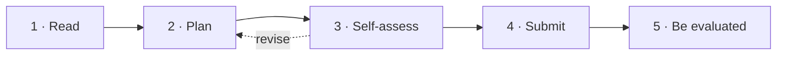

# Competition flow

The challenge asks for a **2035 plan** for a 24.3 km² slice of Hong Kong's Northern Metropolis, produced inside a fixed **HK$10,000,000,000** budget, and delivered as two machine-readable files. The competition looks past the number of buildings: it asks whether spatial design, public services and policy can hold a functioning city together.

## The five stages

### 1 · Read the brief

Establish the planning boundary, land uses, operational constraints and budget, then state objectives. The studio's **Competition guide** carries this material; the **2D map** is where the constraints become visible per zone.

### 2 · Plan with your agent

Two layers, designed together:

**Spatial** — zone areas and functions; construct buildings and building groups with position, footprint, height and use; add or remove walking, vehicle and bus links on the existing network.

**Policy** — a policy for the area or a sub-area, covering cross-boundary exchange, industry incentives, talent and start-up incubation, translated into a structured policy file.

Every spending operation is presented with its cost and only carried out after the participant approves it. Construction and policy share one budget.

### 3 · Self-assess

Check capacity, travel efficiency, service provision and cost against the available scenarios. Self-assessment is a working tool, not the final score — it exists so a participant can find the weak part of their own plan before the committee does.

### 4 · Submit

Exactly two files. There is no presentation deck in the pipeline.

**`spatial_plan.zip`**

| Part | Contents |
|---|---|
| `manifest.json` | format version, CRS, units, planning boundary, base-map version, plan ID, target year 2035, cost totals |
| `plan.gpkg` | zone functions, buildings and building groups, transport network (new/removed walking, vehicle, bus links) |
| `3d/` | 3D Tiles for visualisation, objects matched to `plan.gpkg` by shared identifier |

Function is expressed through zone and building attributes; there are no separate layers for housing, public facilities or industry.

**`policies.yaml`**

Per policy: ID and name, description, objective, target group type and filters, target count and how it is measured, support per target and disbursement method, implementation area and duration. Non-subsidy policies may put `0` in the funding field.

Both files are generated and validated by the system from the participant's final plan. The committee only runs submissions that pass format and basic validation.

### 5 · Be evaluated

The committee rebuilds the submission in a common environment and runs it under common scenario conditions.

**Formal check** — format, object consistency, planning constraints, budget compliance.

**Scenario simulation** — the plan becomes an environment: cross-boundary commuting and Shenzhen exchange, travel to work, school and shops, residential settlement and firm location, start-up formation and venture investment, fire and flood, public-health shocks.

**City-agent simulation** — under the Economic World Model, agents representing households, residents, firms, investors, developers and service organisations choose where to live, where to work, how to travel, what to consume and where to invest. The spatial plan and the policies jointly shape those choices: housing cost moves settlement, transport moves access, business location moves employment, and policy moves the incentives facing each group. Agents then rate the city from their own experience, producing an overall satisfaction measure.

**Expert review** — planners, economists, public-policy specialists and AI researchers weigh novelty, soundness, feasibility and social value.

Final ranking combines simulated indicators, agent satisfaction and expert review.

## What the demo shows of this

The studio's guided scenarios are a compressed, honest walk through stages 2 and 3: intent → proposal → price → approval → build → re-assessment. The **Competition guide** page and `demo-2.mp4` carry stages 1, 4 and 5.

Stage 5 itself is not executed in this build — see [Scope and honesty](../README.md#scope-and-honesty).
